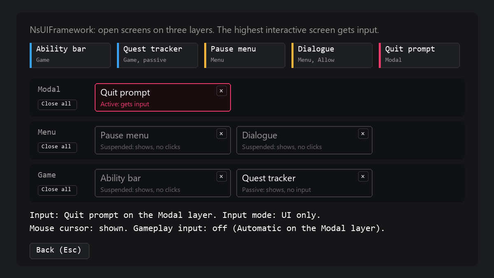

# NsUIFramework User Guide

## Purpose

NsUIFramework controls UI interaction for each local player. It opens and closes screens on three layers, decides which screen gets input, moves the selection with keyboard, mouse, and gamepad, and routes Confirm and Back. It also sets the input mode and the mouse cursor each time the active screen changes. A HUD class opens start screens, and a second subsystem shows floating texts over world points, for example "+3 coins".

NsUIFramework does not style widgets, animate screens, detect the input device, or show input prompt icons. It does not replicate: each machine shows its own UI.

[](Showcase/ScreenStack.html)

## Setup

1. Copy the `NsUIFramework` folder into the `Plugins` folder of your project.
2. Open the project and enable NsUIFramework in Edit > Plugins.
3. For C++, add `"NsUIFramework"` to the module dependencies in `Build.cs`.
4. Generate the project files and build the project.
5. Optional: open Project Settings > Game > NsUI Framework, and change the keys.

No other project settings are necessary.

## Quick Start

### Blueprint

1. Make a Widget Blueprint with `NsUIWidget` as the parent. Add a button to it.
2. In the Level Blueprint, from `Event BeginPlay`, call `Open Screen`.
3. Connect `Get Player Controller` to **Player**.
4. Set **Screen Class** to your widget and **Layer** to `Menu`.
5. Click Play. The screen shows, the mouse cursor shows, and gameplay input stops.
6. Push a Cancel key (Escape or the gamepad Back button). The screen closes, and gameplay input comes back.

### C++

```cpp
#include "NsUISubsystem.h"

UNsUISubsystem* const UI = LocalPlayer->GetSubsystem<UNsUISubsystem>();
UUserWidget* const Screen = UI->OpenScreen(PauseMenuClass, Context, ENsUILayer::Menu);
UI->CloseScreen(Screen);
UI->CloseAll(ENsUILayer::Modal);
```

The subsystem owns the screens that `OpenScreen` makes. It keeps the context object alive until the screen closes.

## Common Tasks

### Make a screen from any widget

1. Open a Widget Blueprint that has another parent class.
2. Open Class Settings.
3. Add the interface `NsUIScreen` to **Implemented Interfaces**.

All screen events are optional. A widget with no interface can also open through `Open Screen`, with the default config.

### Respond to screen events

1. In the screen Blueprint, implement the event of the table below. In C++, override its `_Implementation` function.
2. For `Handle Ns Screen Confirm` and `Handle Ns Screen Cancel`, return true when the screen uses the action.

| Event | Use |
|---|---|
| `Get Ns Screen Config` | Return the layer, **Interactive**, the gameplay policy, and the selection mode class. |
| `On Ns Screen Opened` | Get the context and the selection mode object of this screen. |
| `On Ns Screen Activated` | The screen gets input. **Resumed** is true when the screen had input before. |
| `On Ns Screen Suspended` | The screen loses input but stays open. |
| `On Ns Screen Closed` | The screen closes. Release resources. |
| `Get Ns Screen Selection` | Return automatic selection, a preferred target, or logical input. |
| `Handle Ns Screen Confirm` | Return true to use Confirm before the selected control gets it. |
| `Handle Ns Screen Cancel` | Return true to use Back before the default close. |

### Choose the layer

| Layer | Use | Gameplay input with `Automatic` |
|---|---|---|
| `Game` | HUD parts that take input during play. | Allowed |
| `Menu` | Menus such as pause or settings. | Blocked |
| `Modal` | Popups such as confirmations. | Blocked |

Only the highest interactive screen gets input: Modal, then Menu, then Game. In one layer, the last screen to open has priority. Other interactive screens stay visible but take no clicks.

For `Open Screen`, the **Layer** pin sets the layer. The layer of `Get Ns Screen Config` applies only to a screen that you add with `Add to Viewport`.

### Open screens when play starts

1. Make a Blueprint with `NsUIHUD` as the parent.
2. In **Start Screens**, add an entry for each screen.
3. Set **Screen** to the widget class and **Layer** to the layer. The default layer is `Game`.
4. In your game mode, set **HUD Class** to the new HUD.

The HUD opens the screens in list order on `BeginPlay`, for a local player controller only. Use `Get Start Screen` to get one of them.

### Toggle a screen, for example a pause menu

1. Bind an input action in your player controller.
2. Call `Toggle Screen` with the player controller, the widget class, and the layer.

`Toggle Screen` closes the newest open screen of that class, or opens a new one.

### Close a screen from inside it

1. In the screen, call `Close Screen` with **Self**.

Back also closes a screen that the subsystem opened, when no handler and no selection mode use the action.

### Let gameplay continue under a screen

1. In `Get Ns Screen Config`, set **Gameplay** to `Allow`, for example for dialogue.

With `Allow`, the input mode is game and UI. With the UMG selection mode, the analog sticks go to gameplay, and the digital directions still move the UI selection.

### Show a passive screen

1. In `Get Ns Screen Config`, set **Interactive** to false.

Use it for prompts, toasts, and other screens that take no input.

### Set the first focus

1. In `Get Ns Screen Selection`, set **Preferred Target** to a widget of the screen.

A preferred target does not replace a valid selection that the player made.

### Take all input in the screen

1. In `Get Ns Screen Selection`, set **Policy** to `Logical`.

With `Logical`, no control takes focus and no UI cursor shows. The navigation keys do nothing. Confirm and Back go to `Handle Ns Screen Confirm` and `Handle Ns Screen Cancel`.

### Select actors or world points

This task needs C++, because `SetCandidates` is not a Blueprint function.

1. In `GetNsScreenConfig`, set `SelectionMode` to `UNsUIActorSelectionMode` or `UNsUILocationSelectionMode`.
2. In `OnNsScreenOpened`, cast the selection mode to that class.
3. Call `SetCandidates` with weak actor pointers, or with `FNsUILocation` entries (an id and a position).
4. In `HandleNsScreenConfirm`, read `GetSelectedActor` or `GetSelectedId`.

The arrows move to the nearest candidate in that direction. The mouse selects a candidate within 24 pixels, and a left click on a candidate also confirms. Only candidates on screen can be selected. Location ids must be unique and not empty. The mode drops other entries. Candidate order breaks ties.

### Use a widget made with Add to Viewport

1. Implement `NsUIScreen` on the widget.
2. Add it to the viewport for the same local player.
3. Remove it from the viewport when you are done.

The subsystem finds the widget and gives it input by its config. `Close Screen`, `Close All`, and Back do not remove it.

### Show a floating text in the world

1. Make a Widget Blueprint with `NsUIWorldPopupWidget` as the parent.
2. Add a Text Block named `PopupText`.
3. In the class defaults, set the motion values. The World popup widget table under Settings lists them.
4. Get the `NsUIWorldPopupSubsystem` of the local player.
5. Call `Show Popup` with the class, the text, a location, and a color.

```cpp
UNsUIWorldPopupSubsystem* const Popups = LocalPlayer->GetSubsystem<UNsUIWorldPopupSubsystem>();
Popups->ShowPopup(PopupClass, FText::FromString(TEXT("+3 coins")), FVector(0.f, 0.f, 100.f), FLinearColor::Yellow, TargetActor);
```

With a follow actor, the location is an offset from that actor. Without one, the location is a world point. The popup shows only for the player who calls it. A game that wants every player to see an event calls `Show Popup` on every machine, for example from a replicated event. Implement `On Popup Started` in the widget to react to a new popup, for example to show an icon.

## Settings

### Project settings

Project Settings > Game > NsUI Framework:

| Setting | Default | Effect |
|---|---|---|
| **Confirm Keys** | Enter, Space Bar, gamepad Accept | Keys for Confirm |
| **Cancel Keys** | Escape, gamepad Back | Keys for Back |
| **Navigate Up Keys** | Up, D-pad Up | Keys that move the selection up |
| **Navigate Down Keys** | Down, D-pad Down | Keys that move the selection down |
| **Navigate Left Keys** | Left, D-pad Left | Keys that move the selection left |
| **Navigate Right Keys** | Right, D-pad Right | Keys that move the selection right |
| **Navigate Next Keys** | Tab | Keys that move to the next control |
| **Navigate Previous Keys** | None | Keys that move to the previous control. Shift+Tab always moves back |
| **Cursor Velocity** | 20 | The speed of the UI cursor toward the selection. A higher value is faster |
| **Cursor Lerp Curve** | Cubic from (0, 0) to (1, 1) | The curve on the cursor motion |

### Screen config (`Get Ns Screen Config`)

| Setting | Default | Effect |
|---|---|---|
| **Layer** | `Menu` | The layer of a screen added with `Add to Viewport` |
| **Interactive** | true | False makes a passive screen that never gets input |
| **Gameplay** | `Automatic` | `Automatic` allows gameplay input on `Game` only. `Allow` and `Block` force it |
| **Selection Mode** | None | None uses `NsUIUMGSelectionMode` |

### Selection request (`Get Ns Screen Selection`)

| Setting | Default | Effect |
|---|---|---|
| **Policy** | `Automatic` | `Logical` takes all input in the screen handlers |
| **Preferred Target** | None | The widget to select when nothing is selected |

### HUD (`NsUIHUD`)

| Setting | Default | Effect |
|---|---|---|
| **Start Screens** | Empty | The screens to open on `BeginPlay`, in order. Each entry has a **Screen** class and a **Layer** (default `Game`) |

### World popup widget

Class defaults of a `NsUIWorldPopupWidget` child:

| Setting | Default | Effect |
|---|---|---|
| **Lifetime** | 1.2 s | The time that the popup shows |
| **Rise Speed** | 45 cm/s | The upward speed in the world |
| **Max Distance** | 3000 cm | The popup hides beyond this distance from the camera |
| **Fade In Seconds** | 0.1 s | The fade in at the start |
| **Fade Out Seconds** | 0.4 s | The fade out at the end |
| **Pop Scale** | 1 | The scale at the start. The popup shrinks to scale 1 |
| **Pop Seconds** | 0.2 s | The time from the pop scale to scale 1 |
| **Hide When Blocked** | true | Hides the popup while a Visibility trace from the camera hits something |
| **Max Active** | 4 | The most popups of this class for one player. A new popup over the limit ends the oldest one |
| **Stack Height** | 30 cm | The extra height for each popup that follows the same actor |
| **Viewport Z Order** | -100 | The viewport order. A lower value draws under other viewport widgets |

## Debug

These console commands exist in the editor only:

| Command | Effect |
|---|---|
| `ns.UI.Inspect` | Opens the NsUI Inspector tab. It shows the first local player: the user index, the suspended state, the recovery reason, and each screen with its layer, its state, its owner, its selection mode, and its selection. |
| `ns.UI.SmokeTest.Toggle` | Opens or closes the smoke test screen on the `Menu` layer. Its buttons open a menu, a modal, a viewport screen, an actor selection screen, and a location selection screen, and add or remove a control. |

In the actor selection screen of the smoke test, Confirm destroys the selected actor. Back closes the actor and location selection screens.

## Troubleshooting

| Problem | Cause | Fix |
|---|---|---|
| `Open Screen` returns None | The class is None, the local player has no player controller yet, or the world is not a game world. | Open the screen after the player controller exists, for example from `NsUIHUD`. |
| A viewport widget gets no input | The widget does not implement `NsUIScreen`, or it belongs to another local player. | Implement the interface, and create the widget for the right player. |
| A screen shows but takes no clicks | A higher screen is active, or the screen is not interactive, not visible, or disabled. | Close the higher screen, or set **Interactive**, visibility, and **Is Enabled**. |
| Back does not close a screen | The screen came from `Add to Viewport`, or a handler or the selection mode used Back. | Remove the widget in `Handle Ns Screen Cancel`. |
| UI input stops after a click outside the game, Shift+F1, or a switch to another app | The subsystem suspends while the game viewport has no focus. | Click in the game viewport. |
| A popup does not show | No player controller, the popup is beyond **Max Distance** or behind the camera, or a wall blocks it with **Hide When Blocked** on. | Move closer, or turn off **Hide When Blocked**. |
| A popup has no text | The widget has no Text Block named `PopupText`. | Add the Text Block, or show the text in `On Popup Started`. |
| A popup ends early | Its follow actor was destroyed, or **Max Active** popups of the class already show. | Raise **Max Active**, or use no follow actor. |

## Limits

- The mouse cursor shows whenever a screen is active, also on the `Game` layer.
- The UI cursor follows the selected target. Logical input has no UI cursor. The cursor brush is fixed in code.
- Tab and Shift+Tab always navigate, also when Tab is not in **Navigate Next Keys**.
- Selection recovery runs on the next tick, after the Slate event. Editor interaction, Shift+F1, and a lost app focus pause it.
- The actor and location selection modes take their candidates from C++ only. Blueprint cannot extend `NsUISelectionMode`.
- No device detection and no prompt icons.
- The screen subsystem works only in game worlds.
