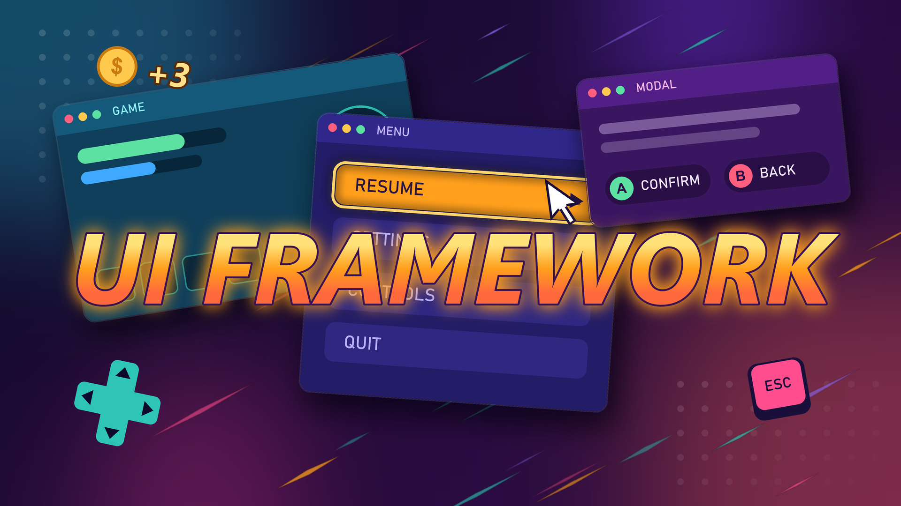

<!-- GH_ONLY_START -->
<h1 align="center">
  <br>
  <a href="https://github.com/mykaadev/NsUIFramework"></a>
</h1>

<h4 align="center">Widgets on layers, focus, and UI input from Enhanced Input for Unreal Engine.</h4>

<div align="center">
    <a href="https://github.com/mykaadev/NsUIFramework/commits/main"></a>
    <a href="https://github.com/mykaadev/NsUIFramework/issues"></a>
    <a href="https://github.com/mykaadev/NsUIFramework/pulls"></a>
    <a href="https://github.com/mykaadev/NsUIFramework"></a>
    <a href="https://twitter.com/mykaadev/"></a>

<p style="display:none;">
  <a href="#-summary">👀 Summary</a> •
  <a href="#-features">📦 Features</a> •
  <a href="#-requirements">⚙️ Requirements</a> •
  <a href="#-installation">🛠️ Installation</a> •
  <a href="#-getting-started">🚀 Getting Started</a> •
  <a href="#-layers-and-input">🗂️ Layers and Input</a> •
  <a href="#-api">🔧 API</a> •
  <a href="#-limits">🚧 Limits</a> •
  <a href="#-documentation">📚 Documentation</a> •
  <a href="#-credits">❤️ Credits</a> •
  <a href="#-support">📞 Support</a> •
  <a href="#-license">📃 License</a>
</p>
<a href="https://buymeacoffee.com/mykaadev"></a>
<p><b>Buy me a coffee!</b></p>
</div>
<!-- GH_ONLY_END -->

## 👀 Summary
NsUIFramework controls UI interaction for each local player. It opens and closes widgets on three layers, decides which widget gets input, gives the focus to a control, and routes Confirm, Back, the directions, and the tabs. The UI keys come from Enhanced Input actions, so player remaps apply to the UI. A key goes to the focused control first, so text boxes and the console keep their keys. The framework also sets the input mode and the mouse cursor, so game code does not call `SetInputMode`. A HUD class opens start widgets, and a second subsystem shows floating texts over world points.

NsUIFramework does not style widgets and does not animate them. It does not replicate: each machine shows its own UI.

## 📦 Features
- **Widget stack**: Open and close widgets on the `Game`, `Menu`, and `Modal` layers. Only one widget gets input: the highest layer, then the newest.
- **Any widget**: Use `UNsUIWidget` as the parent, or implement `INsUIWidgetInterface` on any `UUserWidget`.
- **Enhanced Input keys**: Confirm, Back, the directions, and the tabs are input actions. Player remaps apply to the UI.
- **Text boxes and console**: A key that a control uses never becomes a UI action.
- **Confirm and Back**: One place to handle them, in the widget events. By default, Back closes the widget.
- **Input policies**: `Passive`, `UIOnly`, `UIAndGame`, and `GameFirst`, for a menu, a HUD, or a dialogue that runs during play.
- **Focus**: A default focus, focus restore, hover as focus, and a focus event for the focus look and sound.
- **Selection modes**: Directional selection of actors and world points on screen, with keys, a gamepad, or the mouse.
- **External widgets**: A widget that another system adds to the viewport still gets Confirm and Back.
- **Start widgets**: `ANsUIHUD` opens a list of widgets when play starts.
- **World popups**: Pooled floating texts such as "+3 coins" that rise and hide behind walls.
- **Optional modules**: A selection cursor that glides with NsTween, and device sync with NsInput.
- **Debug tools**: `ns.UI.Inspect`, an inspector tab, and automation tests.

## ⚙️ Requirements
Unreal Engine 5.7+

The Enhanced Input plugin. Optional: NsTween, NsInput.

## 🛠️ Installation
1. **Clone** or download this repository.
2. Copy the `NsUIFramework` folder into the `Plugins` folder of your project.
3. For C++, add `"NsUIFramework"` to the module dependencies in `Build.cs`.
4. Generate the project files and enable the plugin.
5. Open Project Settings > Plugins > Ns UI Framework. Set **Input Mapping Context** to `IMC_NsUI` and each **Input Actions** entry to its `IA_NsUI_` action from the plugin content.

## 🚀 Getting Started
Blueprint:
1. Make a Widget Blueprint with `NsUIWidget` as the parent.
2. Call `Open Widget` with a player controller, the widget class, and the layer `Menu`.
3. Call `Close Widget` with the widget to close it, or push Back.

C++:

```cpp
#include "NsUISubsystem.h"

UNsUISubsystem* const UI = LocalPlayer->GetSubsystem<UNsUISubsystem>();
UUserWidget* const Pause = UI->OpenWidget(PauseMenuClass, Context, ENsUILayer::Menu);

UI->CloseWidget(Pause);
UI->CloseAll(ENsUILayer::Modal);
```

The subsystem owns the widgets that `OpenWidget` makes. It keeps the context object alive until the widget closes.

To handle Confirm and Back, implement `Handle Confirm` and `Handle Back` in the widget. In C++, override `HandleConfirm_Implementation` and `HandleBack_Implementation`. Return true when the widget uses the action.

## 🗂️ Layers and Input
| Layer | Use |
|---|---|
| `Game` | HUD parts and widgets of play |
| `Menu` | Menus such as pause or settings |
| `Modal` | Popups such as confirmations |

Modal comes first, then Menu, then Game. In one layer, the last widget to open has priority.

| Input policy | Input |
|---|---|
| `Passive` | No input. For prompts, toasts, and HUD parts |
| `UIOnly` | The default. The UI takes all input |
| `UIAndGame` | The UI takes the UI actions. All other keys and the sticks go to the game |
| `GameFirst` | The game keeps the focus. `HandleConfirm` and `HandleBack` also get their keys, for example for a dialogue line |

## 🔧 API
### Widgets
- `UNsUISubsystem` – The local player subsystem: `OpenWidget`, `CloseWidget`, `ToggleWidget`, `CloseAll`, `FindWidget`, `IsWidgetOpen`, `GetActiveWidget`, `RefreshConfig`, `FocusChild`, `RestoreFocus`, `AddExternalWidget`, and `GetKeysForAction`.
- `UNsUIFunctionLibrary` – Blueprint shortcuts from a player controller: `OpenWidget`, `ToggleWidget`, `CloseWidget`, `GetUISubsystem`.
- `ANsUIHUD` – A HUD that opens its `StartWidgets` on `BeginPlay` and closes them on `EndPlay`.
- `INsUIWidgetInterface` – The widget contract. All events are optional.
- `UNsUIWidget` – A `UUserWidget` parent that implements `INsUIWidgetInterface`.
- `FNsUIWidgetConfig` – The input policy, the focus policy, the selection mode class, and the mouse cursor.
- `UNsUISettings` – The UI input actions, the selection cursor class, and the viewport orders.

### Widget Events
- `GetConfig` – Return the config of the widget.
- `GetFocus` – Return the preferred first focus.
- `OnOpened` / `OnClosed` – Get the context and the selection mode, and release resources.
- `OnActivated` / `OnDeactivated` – The widget gets input, or loses it but stays open.
- `OnFocusChanged` – The focus moved to another control.
- `HandleConfirm` / `HandleBack` / `HandleNavigate` / `HandleTab` – Use an action before the default.
- `BeginClose` – Play an outro, then call `FinishCloseWidget`.

### Selection
- `UNsUIActorSelectionMode` / `UNsUILocationSelectionMode` – Select actors or world points. Call `SetCandidates`, then read `GetSelectedActor` or `GetSelectedId`.
- `UNsUIWorldSelectionMode` – The base class for a new source of world candidates, in C++.
- `UNsUICursorWidget` – The parent class of the selection cursor. `UNsUITweenCursorWidget` glides with NsTween.

### World Popups
- `UNsUIWorldPopupSubsystem` – The local player subsystem: `ShowPopup`, `ClearPopups`, `GetActivePopupCount`.
- `UNsUIWorldPopupWidget` – The parent class of a popup widget. Its class defaults and its `Appear` and `Disappear` animations set the motion.

### Debug
- `ns.UI.Inspect` – Logs the open widgets, the active widget, the UI keys, and the focus. Not in Shipping.
- NsUI Inspector – An editor tab with the same state for each play world.
- `NsUIFramework.*` – Automation tests for the widget stack and the input routing.

## 🚧 Limits
- While a text box has the focus, keyboard keys are never UI actions. A gamepad Confirm and Back still work.
- A widget that hides its controls when it opens calls `RestoreFocus` when they show.
- A widget that another system shows must use the `GameFirst` or `Passive` input policy.
- The framework does not tell an Xbox pad from a PlayStation pad. NsInput does that for the prompt icons.
- The subsystem works only in game worlds.

## 📚 Documentation
- [User Guide](https://mykaadev.github.io/plugins/nsuiframework/user-guide/) – Setup, common tasks, settings, debug tools, and the migration from v1.
- [Technical Documentation](https://mykaadev.github.io/plugins/nsuiframework/tech-documentation/) – Architecture, input flow, data ownership, lifetime, and extension points.

<!-- GH_ONLY_START -->
## ❤️ Credits
<a href="https://github.com/mykaadev/NsUIFramework/graphs/contributors"></a>

## 📞 Support
Reach out via the **[profile page](https://github.com/mykaadev)**.

## 📃 License
[](https://www.tldrlegal.com/license/mit-license)
<!-- GH_ONLY_END -->
